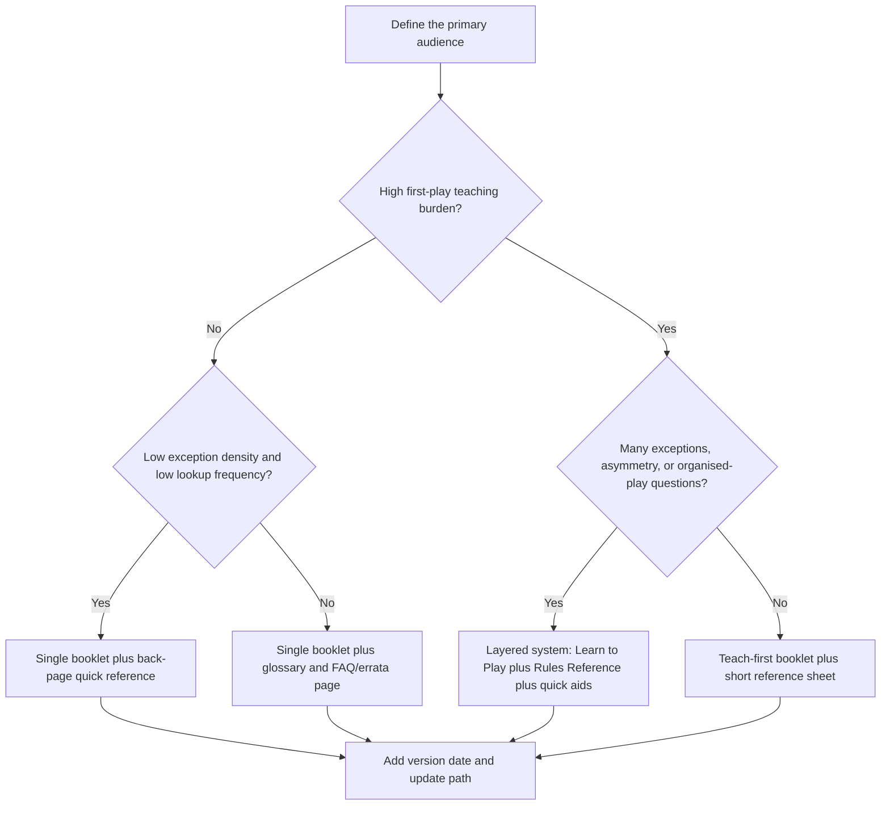
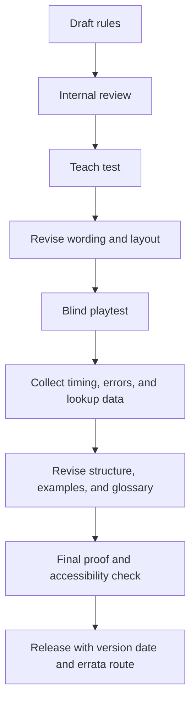

# Writing Good Rulebooks for Games

## Executive summary

A strong game rulebook is not a single text doing a single job. In practice, it usually has to do at least three things well: teach a first play, resolve ambiguous or edge-case situations during later play, and support after-publication maintenance through glossaries, errata, updates, and versioning. Official publishers repeatedly separate those jobs rather than forcing one document to do everything at once. Catan explicitly tells new players to read an overview, then the short game rules, then consult an almanac during play; Root separates a conversational *Learning to Play* guide from the formal *Law*; Fantasy Flight commonly publishes a *Learn to Play* plus a *Rules Reference*; Magic splits its beginner-facing “How to Play” from a formal *Comprehensive Rules* document; One Piece does the same with an official rule manual, comprehensive rules, tournament rules, and a playsheet; and D&D Beyond separates player-facing, Dungeon Master-facing, and monster content. citeturn7view0turn9view0turn0search9turn0search13turn25view0turn26view2turn33view0

The best structure therefore depends less on genre labels alone and more on teaching burden, exception density, asymmetry, and how often players need to look up rules mid-play. Light, low-exception board and card games can succeed with one booklet plus a back-page quick reference; medium or heavy games usually benefit from layered documentation; asymmetric or competitive games often need a strict reference document; and tabletop RPGs nearly always benefit from clear audience separation between player rules, facilitator or GM guidance, and adversary or reference material. Official examples align strongly with that pattern. citeturn7view0turn9view0turn16view4turn25view0turn26view0turn26view2turn33view0turn4search14

On the sentence level, the evidence is similarly consistent. Plain-language standards recommend defining the audience first, organising information up front, writing in active voice, using direct second-person address where helpful, defining specialised terms, and explaining jargon in ordinary language when it cannot be avoided. Government and technical style guides also support short, scannable sentences and explicit definitions of technical terms. For beginner-facing rulebooks, a sensible drafting target is plain language with a Flesch Reading Ease around 60–70 and a Flesch-Kincaid Grade Level around 7–8, while recognising that readability formulae are only proxies and must be checked against the real audience through testing. citeturn30view2turn29view0turn29view1turn29view2turn29view3turn28view3turn28view4turn28view2

Layout matters as much as prose. Official rulebooks use typographic signalling, colour coding, card anatomy diagrams, playmats, overview sheets, keyword glossaries, icons, and tutorial aids to reduce cognitive load. Catan visibly colour-codes its layers; Root uses small caps for defined terms, italics for reminders, and icons for modified rules; Magic’s beginner page breaks the game into digestible learning chunks; One Piece provides a play guide and playsheet; and Dized and publisher rule portals increasingly offer learn-while-playing tutorials alongside, not instead of, the written rules. Accessible presentation further requires sufficient colour contrast, non-text alternatives in digital formats, resizable text, and dyslexia-aware typography and colour choices. citeturn17view0turn17view1turn25view0turn26view2turn21search0turn21search2turn28view0turn28view1turn34view0turn7view8

Finally, rulebooks should be tested like products, not merely proofread like manuscripts. Official plain-language guidance recommends testing early, iterating at least twice, and using paraphrase testing or usability testing depending on the length and complexity of the material. Tabletop publishers likewise emphasise blind playtesting, because only unsupervised sessions reveal which rules the document actually teaches and which it only seems to teach when the designer is present. A disciplined authoring process should therefore include version control, component inventories, setup diagrams, troubleshooting aids, legal notices, an errata route, and measurable release criteria. citeturn30view0turn30view1turn24search1turn6search1turn6search7

## Scope, assumptions and criteria

This report focuses on tabletop game rulebooks in English for three explicitly requested families: board games, card games, and tabletop RPGs. It also notes some adjacent but unspecified types where they create materially different documentation needs.

The following assumptions are necessary because the brief leaves some production constraints unspecified:

| Unspecified constraint | Working assumption used in this report |
|---|---|
| Audience literacy | Broad hobby audience, including first-time players and mixed-experience groups |
| English variety | en-GB house style for the authored guide, even where sources use US English |
| Format | A print-first booklet or PDF that may also have a digital companion |
| Companion tools | Videos, searchable rules, or tutorials may supplement but should not replace a complete written core rule set |
| Product lifecycle | The game may receive post-publication FAQ, errata, and localisation |
| Game types not fully specified | Miniatures war games, party games, dexterity games, escape-room games, app-mandatory hybrids, and live-action RPGs are out of primary scope, but their additional needs are noted where the design implications are clear |

The evaluation criteria used here come from a synthesis of official rulebooks and authoritative writing, accessibility, and testing guidance: first-play teachability, mid-game lookup speed, precision of definitions, consistency of terminology, visual scanability, accessibility, localisation readiness, and updateability over time. Those criteria are all explicitly reflected in the source corpus, even when publishers use different labels for them. citeturn7view0turn9view0turn25view0turn26view2turn30view2turn28view0turn28view1turn30view0

A practical consequence of those criteria is that “the rulebook” should be treated as a documentation system rather than a single artefact. Depending on the game, that system may include a booklet, glossary, reference sheet, setup guide, tutorial, FAQ, errata page, searchable digital rules, or all of the above. Official game ecosystems increasingly do exactly this: Stonemaier often pairs rulebooks with videos and Dized or Rulepop tools; One Piece offers rules, a play guide, FAQ, rule updates, and downloadable sheets; Magic offers beginner materials, a glossary, Arena tutorials, and the comprehensive rules; and D&D Beyond packages separate resources for players, DMs, and monsters. citeturn21search2turn10search0turn26view2turn25view0turn33view0

## Purpose and audience of rulebooks

The primary purposes of a rulebook are to establish the game’s objective, teach setup and play order, define legal and illegal actions, resolve disputes, and preserve consistency across tables. Catan’s introduction is unusually explicit about this layered purpose, telling new players to begin with an overview, then the short rules, and then use the almanac for in-game questions; Root and Magic are equally explicit that their formal reference texts are not the same thing as their teaching texts. citeturn7view0turn9view0turn16view4

Different audiences need different answers from the same rules corpus. A first-time player wants to know *what the game is about*, *how to set it up*, *how a turn works*, and *how to win*. An experienced player wants timing windows, exceptions, and keyword precision. A tournament organiser or judge needs a canonical reference and update path. A translator needs stable terminology and consistent structure. A layout artist needs an information hierarchy that can survive page constraints. Official publishers increasingly expose those audiences directly in their document structure: D&D Beyond divides material into *Players*, *Dungeon Masters*, and *Monsters*; One Piece distinguishes beginner materials from comprehensive and tournament materials; Yu-Gi-Oh! offers an official rulebook, a beginner guide, and a simplified Speed Duel entry point. citeturn33view0turn26view2turn26view0

For authors, the key design decision is whether one audience is truly primary. If the answer is yes, optimise the main rulebook around that audience and move other needs to appendices or companion documents. If the answer is no, split the documentation. Catan, Root, Fantasy Flight, Magic, and One Piece all provide strong evidence that layered documentation is not a luxury but a control mechanism for complexity. It lets beginner-facing text stay friendly and short, while preserving a stricter reference layer for disputes and edge cases. citeturn7view0turn9view0turn0search9turn0search13turn25view0turn16view4turn26view2

A useful way to frame audiences is this:

| Audience | Core question | Best document behaviour |
|---|---|---|
| Curious buyer or new player | “What is this game, and can I start?” | Overview, goal, components, setup, first-round tutorial |
| Learner during first play | “What do I do now?” | Stepwise turn sequence, examples, reminders, icon legend |
| Experienced player | “What exactly happens here?” | Precise definitions, glossary, exceptions, index |
| Organiser, judge, or facilitator | “Which rule takes precedence?” | Canonical wording, version date, update path, precedence rules |
| Localiser or translator | “What must stay terminologically consistent?” | Stable glossary, house style, source text without ambiguity |
| Customer support | “How do we answer recurring questions?” | FAQ, troubleshooting, errata, replacements path |

That audience model is consistent with official materials that explicitly separate learning, reference, and maintenance functions. citeturn9view0turn16view4turn26view0turn26view2turn33view0

## Structure and section order

The strongest cross-genre pattern is **layered progression**: start with orientation, move into setup and flow, then expand into detail, then provide lookup tools. Even when publishers package this as multiple documents rather than one, the macro-order remains stable. Stonemaier’s own rulebook template summarises that order as overview and goal, components, setup, gameplay overview, detailed gameplay, other information, and end-of-book reminders; official game documents from Catan, Root, Fantasy Flight, Magic, One Piece, and D&D all instantiate some version of that structure. citeturn21search12turn7view0turn9view0turn0search9turn25view0turn26view2turn33view0

The comparison below synthesises official structures across the requested game types and also notes adjacent types that were not fully specified in the brief. citeturn7view0turn9view0turn0search9turn0search13turn25view0turn26view0turn26view2turn33view0turn4search14

| Game type | Best-fit architecture | Recommended section order | Split docs when… | Official pattern examples |
|---|---|---|---|---|
| Board game | Single booklet for light games; layered booklet plus reference for medium/heavy games | Title and metadata → one-sentence goal → components → setup → round or turn overview → action details → scoring and endgame → glossary / FAQ / reference | The game has asymmetry, many exceptions, advanced modes, or frequent mid-game lookups | Catan overview + short rules + almanac; Root *Learning to Play* + *Law*; Fantasy Flight *Learn to Play* + *Rules Reference* |
| Card game | Beginner guide plus comprehensive rules; often a separate tournament layer | What a card is → setup / play area → turn order → core actions → card anatomy and keywords → examples → glossary → comprehensive or organised-play layer | Keywords, timing windows, deckbuilding exceptions, or organised play matter | Magic beginner guide + *Comprehensive Rules*; One Piece official manual + comprehensive rules + tournament manual + playsheet; Yu-Gi-Oh! rulebook + beginner guide + Speed Duel guide |
| Tabletop RPG | Audience-separated corpus: player rules, GM rules, adversaries, glossary, starter adventure | What play looks like → core resolution → character creation → scene pillars / phases of play → advancement → equipment / spells / options → GM guidance → bestiary / stat blocks → glossary / indexes → starter scenario | The GM’s information would spoil play, or the rules burden is too high for one volume | D&D Beyond *Players*, *Dungeon Masters*, *Monsters*; Call of Cthulhu Quick-Start with investigator creation plus a ready-to-play adventure |
| Miniatures / war games | Often layered plus scenario pack and competitive reference | Components → battlefield setup → sequence of play → line-of-sight and measurement conventions → unit and terrain exceptions → scenarios | Measurement, terrain, and competitive adjudication are dense | Fantasy Flight’s broader *Learn to Play* plus formal rules-reference model is highly relevant here |
| Party / social deduction / dexterity | Extremely short booklet or single-sheet plus component card aids | Goal → setup → turn structure → permitted speech / physical actions → win conditions → tie-breaks | The game depends on hidden roles, noisy table talk, or physical constraints | Usually closer to beginner-first board-game structure than to layered reference |
| App-led hybrids | Printed quick-start plus digital rules / FAQ / onboarding | Safety / requirements → setup → account or app steps → first round → recovery from tech problems → printed failsafes | The app enforces timing, hidden information, or scenario variation | Should still include a complete fallback explanation of the physical system even if the app governs play |

A simple decision rule for document architecture is shown below. It generalises the patterns visible in official layered systems such as Catan, Root, Fantasy Flight, Magic, D&D, and One Piece. citeturn7view0turn9view0turn0search9turn25view0turn26view2turn33view0



For board games in particular, the most reliable section order is: **overview and goal, components, setup, turn overview, detailed turn rules, scoring, endgame, reference**. For card games: **setup, card anatomy, turn order, action rules, timing and keywords, deckbuilding or format notes, glossary, comprehensive rules**. For tabletop RPGs: **what play is, core resolution, character creation, phases of play, player options, advancement, GM guidance, adversaries, glossary / indexes, starter scenario**. Those are recommendations, not laws, but they are strongly supported by the official structures above. citeturn7view0turn25view0turn26view2turn33view0turn4search14

## Writing style and language mechanics

Good rulebooks are instructional documents, not literary essays. The most robust external guidance therefore comes from plain-language and technical-writing standards: write for the actual audience, organise from the user’s task, prefer short and simple sentences, use the active voice, and use words the audience already knows where possible. GOV.UK, Canada.ca, the ONS service manual, Digital.gov, and the Australian Style Manual all converge on those points. citeturn30view2turn29view0turn29view1turn29view2turn29view3turn28view4

Tone should be clear, direct, and steady rather than chatty, ironic, or theatrical. Humour can work in flavour text or examples, but the core rules should not rely on it for comprehension. Official documents that are easiest to adjudicate later, such as Root’s *Law* and Magic’s *Comprehensive Rules*, keep voice subordinate to precision, whereas beginner-facing texts like Catan’s introductory pages, Magic’s “How to Play,” or Yu-Gi-Oh!’s beginner materials use more approachable phrasing without sacrificing sequence clarity. The right design principle is not “be formal” or “be informal”; it is “be as warm as possible without making a rule less testable”. citeturn17view0turn17view1turn25view0turn26view0turn16view4

For procedures, use the imperative where the reader must perform an action. That pattern appears throughout beginner-facing official rules: Catan says, in effect, to select a colour and take your pieces; Magic tells players to shuffle, draw, choose a life tracker, and decide who goes first. For state descriptions, eligibility conditions, or invariant truths, use descriptive declarative sentences instead: Root states that the first player to reach 30 victory points wins immediately; Magic’s comprehensive rules state that specific rules apply to specific forms of play. In other words, **imperative for what the reader does; descriptive for what the game system is**. citeturn16view0turn25view0turn9view0turn17view2

Definitions must be stable and unambiguous. Root is exemplary here: it explicitly says small caps define key terms, that terms are defined strictly in the glossary, and that near-synonyms such as *move* and *place* are different actions. Magic’s comprehensive rules use numbered rules and a glossary for the same reason. Canada.ca’s style guidance similarly recommends explaining technical terms on first mention. For a rulebook author, the operational rule is straightforward: **define once, reuse exactly, never vary a critical verb for style**. citeturn16view5turn16view4turn29view1

Jargon should be reduced, not romanticised. If a specialist or legal term must remain, explain it in ordinary language at first use; GOV.UK says legal content can still be written in plain English and that jargon should be explained when there is a clear user need to include it. That principle matters especially for hobby games, which often inherit opaque terms from genre tradition. “Exhaust”, “priority”, “stack”, “trigger”, “initiative”, “dominance”, or “line of fire” may be fine, but they must be anchored to visible definitions, examples, or glossaries. citeturn29view0turn30view2turn16view5turn16view4

A sensible readability target for learn-to-play text is plain language aimed at ordinary adult readers rather than expert hobbyists. Microsoft’s readability guidance recommends a Flesch Reading Ease of 60–70 and a Flesch-Kincaid Grade Level around 7–8 for many documents. That should be treated as a drafting checkpoint, not a release criterion: W3C’s reading-level guidance and Digital.gov’s plain-language materials both imply that real-user testing matters more than formula scores alone, especially where diagrams, examples, tables, and prior knowledge affect comprehension. citeturn28view3turn28view2turn30view0turn28view4

The table below gives a practical grammar model for rule text, derived from the official materials above. citeturn16view0turn9view0turn25view0turn29view1turn29view2

| Rule function | Preferred sentence form | Example style |
|---|---|---|
| Player procedure | Imperative or direct second person | “Draw 5 cards.” / “Choose a leader.” |
| Turn sequence | Ordered descriptive statements with clear headings | “Each round has three phases…” |
| Win condition | Descriptive declarative statement | “The first player to reach 30 points wins immediately.” |
| Restriction or prohibition | Explicit, absolute wording | “You cannot…” / “Only if…” |
| Definition | Term followed by stable meaning | “Adjacent means…” |
| Exception | Base rule first, then override | “Normally X. However, if Y…” |
| Reminder or teaching note | Visually separated note or example, not embedded in the operative sentence | “Example:” / “Reminder:” |

## Layout, pedagogy, accessibility and localisation

Visual hierarchy is part of the rules, not decoration. Catan’s colour coding makes its teaching layers visible: the document tells the reader that different sections serve different purposes, and the page design reinforces that. Root goes even further by assigning different jobs to typographic styles: small caps for defined terms, italics for reminders or clarifications, and faction icons for modified rules. Magic’s beginner page organises instruction into visually discrete chunks with repeated “setup / casting / turn / combat” blocks. The lesson is that headings, typography, colour, icons, and callouts should each have one defined semantic role and keep that role consistently. citeturn7view0turn17view0turn9view0turn17view1turn25view0

Examples, diagrams, flowcharts, overview sheets, and quick references should appear close to the rule they explain, not in a distant appendix. Magic teaches setup and card anatomy visually; One Piece provides a play guide and playsheet; Yu-Gi-Oh! offers a beginner guide and a simplified alternative ruleset; and Dized’s official positioning is explicitly “learn while you play”, including setup guidance tailored to player count. Stonemaier’s rules pages similarly often place the rulebook alongside tutorials, videos, or searchable references. The implication for authors is that a modern rules system should include at least one **teaching layer**, one **lookup layer**, and one **memory-refresh layer**. citeturn25view0turn26view2turn26view0turn21search0turn21search2

FAQs and troubleshooting are not admissions of failure; they are recognition that players ask repeated questions. Root provides rules and errata paths, One Piece maintains official rule updates and errata notices, and Catan’s almanac is effectively a built-in FAQ structure keyed off the shorter game rules. Especially for games with expansions, errata, or tournament ambiguity, a visible update route belongs in the documentation plan from the start. citeturn8view2turn26view2turn7view0

Accessibility should be designed into both print and digital forms. WCAG 2.2 requires text contrast of at least 4.5:1 for normal text, 3:1 for large text, and 3:1 for meaningful non-text graphics or controls; it also requires text alternatives for non-text content in digital materials and supports resizing text up to 200 percent without loss of content or function. The British Dyslexia Association’s guidance complements this with print-facing advice: use a plain sans serif face, around 12–14 point as a baseline, dark text on a light but not pure white background, and avoid relying on red/green or pink/green distinctions. citeturn28view1turn28view0turn34view0turn7view8

For localisation, it helps to distinguish translation from localisation. Microsoft defines translation as changing the language, and localisation as adapting content and products to the expectations of a specific locale. In practice, a localisable rulebook should maintain a stable glossary, avoid idioms and culture-bound jokes in core procedures, avoid layout that bakes text into images, and give translators editable source files plus a termbase. One Piece’s official rules infrastructure demonstrates documentation prepared for multiple languages, including overview sheets in several languages and centrally managed update notices. citeturn32view0turn26view2

The two sample page mockups below are proposed layouts derived from those official practices. The first is a **teaching spread**; the second is a **reference page**. They are especially suitable for print-first PDF rulebooks with optional digital companions. citeturn17view0turn17view1turn25view0turn26view2turn28view1turn7view8

```text
Sample teaching spread

┌──────────────────────────────────────────────────────────────────┐
│ GAME TITLE   2–4 players   30–45 mins   Age 12+   v1.0          │
├──────────────────────────────────────────────────────────────────┤
│ Goal in one sentence: Be the first player to ...                │
├───────────────────────────────┬──────────────────────────────────┤
│ Setup diagram                 │ First round at a glance          │
│ labelled with 1–6 callouts    │ 1. Draw                          │
│                               │ 2. Place                         │
│                               │ 3. Resolve                       │
├───────────────────────────────┼──────────────────────────────────┤
│ Components with counts        │ Turn order with icons            │
│ icon + name + quantity        │ each icon repeated in text       │
├───────────────────────────────┼──────────────────────────────────┤
│ Example box                   │ Reminder box                     │
│ one worked scoring example    │ “You cannot…” / “Only if …”      │
├───────────────────────────────┴──────────────────────────────────┤
│ Footer: page refs to glossary, FAQ URL, and back-page summary   │
└──────────────────────────────────────────────────────────────────┘
```

```text
Sample reference page

┌──────────────────────────────────────────────────────────────────┐
│ 5. Combat                                                        │
├──────────────────────────────────────────────────────────────────┤
│ Rule summary in one sentence                                     │
├───────────────┬──────────────────────────────────────────────────┤
│ 5.1 Timing    │ 5.2 Effect resolution                            │
│ numbered      │ numbered                                          │
│ subrules      │ subrules                                          │
├───────────────┼──────────────────────────────────────────────────┤
│ 5.3 Keywords  │ 5.4 Exceptions                                   │
│ alphabetised  │ “If this conflicts with X, follow Y”             │
├───────────────┴──────────────────────────────────────────────────┤
│ Margin signals:                                                   │
│ ■ definition   ▲ example   ! reminder   ⓘ faction / mode icon    │
├──────────────────────────────────────────────────────────────────┤
│ Footer: index terms, version date, errata path                    │
└──────────────────────────────────────────────────────────────────┘
```

A corresponding pedagogic flow is shown here. It reflects the official progression from beginner materials to deeper references and live support documents. citeturn25view0turn26view0turn26view2turn21search0turn33view0


## Testing, legal notes, templates and annotated exemplars

Rulebooks should be tested with the same seriousness as mechanics. Digital.gov recommends testing as soon as you have enough material, not waiting for perfection, and planning to test at least twice. It distinguishes paraphrase testing for shorter chunks from full usability testing for longer documents where people must find and understand information. For usability tests, it recommends three to five participants per round, about an hour per session, and scenario-based tasks. That maps cleanly onto game rulebooks: you can ask people to set up, explain the win condition, take the first turn, resolve a combat, or find an exception without designer help. citeturn30view0turn30view1

Tabletop publishers arrive at the same conclusion from the opposite direction. Stonemaier explicitly says blind playtesting improves the rulebook, and elsewhere notes that blind playtesters must rely on the rulebook, cards, and visual aids because the designer is absent. That makes blind playtests the closest thing tabletop games have to document usability testing. A release candidate rulebook should therefore pass both **taught playtests** and **blind playtests**. The former verify the game’s fun and pacing; the latter verify whether the writing actually teaches. citeturn24search1turn6search1turn6search7

A practical testing protocol is to run three rounds. First, do an internal comprehension pass with people who know the game but did not write the rules. Second, run a semi-blind test where observers answer nothing unless the group is stalled. Third, run truly blind tests with only the packaged materials. Measure time to setup, time to first legal turn, number of rules queries, number of incorrect setups, number of incorrect action attempts, and whether players can restate the win condition before and after play. Those metrics are a direct adaptation of usability-testing guidance and blind-playtesting practice. citeturn30view0turn30view1turn24search1turn6search7

Common failure modes are predictable. They include undefined terms, inconsistent verbs for distinct actions, burying the win condition, mixing examples into operative rules without signalling the difference, relying on colour without labels, omitting component counts, offering no update route, and forcing first-time readers to encounter exceptions before they understand the core loop. That list is partly an inference from what the best official rulebooks go out of their way to prevent: Catan surfaces overview and lookup layers, Root formalises defined terms and precedence, Magic formalises hierarchy, and One Piece exposes update channels and multiple rule surfaces. citeturn7view0turn16view5turn16view4turn26view2

Legal and production details should be minimal but explicit. At minimum, include an edition number or version date, copyright and trademark attribution, contact or support routing, and an errata or update location. D&D Beyond’s Basic Rules include copyright and trademark language; Magic and Root place effective dates or dated rule versions prominently; and One Piece maintains centralised rule updates and errata notices. If the game includes safety-sensitive pieces or age-sensitive claims, those also belong in the publication metadata. citeturn33view0turn16view4turn9view0turn26view2

Components lists and setup diagrams need operational precision. Catan is a strong baseline example because it combines exact counts, named component categories, and stepwise setup instructions tied to a visual board layout. Root’s appendices show how component sections can scale when the game has many faction- or pack-specific parts. The author’s rule should be: name, count, category, and if relevant show one image of each component type with a matching label used later in the rules. citeturn16view2turn16view0turn17view0turn16view5

What follows is a practical author toolkit derived from those sources.

A **generic layered template** for board and card games:

| Section | Purpose | Notes for the author |
|---|---|---|
| Cover metadata | Identify game, players, playtime, age, version | Add edition or version date |
| Overview and goal | Explain what players are trying to do | One short paragraph only |
| Components | Help the reader verify the box | Use counts, images, and names consistently |
| Setup | Get players to a legal starting state | Pair steps with a diagram |
| Turn or round overview | Give the reader the whole loop before exceptions | One page if possible |
| Core actions | Explain what players can usually do | Put the most common action first |
| Scoring and endgame | State win condition early, then repeat with detail | Do not bury this near the end only |
| Exceptions / variants | Advanced rules, multiplayer changes, solo, campaign | Separate from first-play sequence |
| Glossary / index / FAQ route | Support lookup and edge cases | Add page references and digital update path |

A **generic tabletop RPG template**:

| Section | Purpose | Notes for the author |
|---|---|---|
| What play looks like | Frame conversation, roles, and core loop | New readers need the social model first |
| Core resolution | Explain dice, tests, checks, or moves | Keep this before character options |
| Character creation | Build a playable character quickly | Provide a fast path and a full path |
| Core phases of play | Exploration, scenes, combat, downtime, etc. | Use examples generously |
| Advancement and options | Growth, spells, equipment, feats, moves | Keep player-facing content together |
| GM guidance | Running scenes, difficulties, adjudication, safety tools | Separate spoilers and authority |
| Adversaries / stat blocks | Reference content for play | Include anatomy diagrams for stat blocks |
| Starter scenario | Teach by doing | Quick-start products especially benefit |
| Glossary / indexes / sheets | Lookup and ongoing support | Essential for long-form use |

A **release checklist**:

| Check | Pass criterion |
|---|---|
| Goal clarity | A new reader can state the win condition after the first page |
| Setup fidelity | A blind group can set up correctly without outside help |
| Terminology | Every rule-critical noun and verb is defined and used consistently |
| Core loop | The turn order is visible in one place before exceptions appear |
| Examples | Every difficult subsystem has at least one worked example |
| Lookup support | Glossary, page refs, and quick reference exist |
| Accessibility | Contrast, font choice, icon legibility, and localisation readiness checked |
| Digital resilience | PDF bookmarks, searchable text, and text alternatives added where relevant |
| Versioning | Version date, copyright, and errata route included |
| Testing | At least two iterated test rounds, including blind play |

The iteration loop should itself be documented. A lightweight process, adapted from usability guidance and blind playtesting practice, looks like this. citeturn30view0turn30view1turn24search1turn6search7



Finally, a few short annotated excerpts from real rulebooks show best practice in miniature. Each quote is intentionally brief for compliance and precision.

| Source | Short excerpt | Why it works |
|---|---|---|
| Catan | “read the Game Rules… consult the Catan Almanac” citeturn7view0 | It tells the reader which document layer to use and when, reducing first-play overload. |
| Root *Law* | “Text in small capitals defines key terms.” citeturn16view5 | It assigns a specific semantic job to typography, which improves both reading speed and adjudication. |
| Magic *Comprehensive Rules* | “ultimate authority” and “numbered rules followed by a glossary” citeturn16view4turn16view3 | It states hierarchy and document purpose plainly; players know this is a reference, not a tutorial. |
| D&D Beyond Basic Rules | “Players”, “Dungeon Masters”, “Monsters” citeturn33view0 | It separates audiences before content, which is especially important in RPGs. |
| One Piece Card Game rules hub | “Official Rule Manual”, “Comprehensive Rules”, “Tournament Rules Manual”, “Playsheet” citeturn26view2 | It demonstrates a mature documentation family: learn, look up, compete, and refresh. |
| Yu-Gi-Oh! rules hub | “Speed Dueling… the perfect introduction” citeturn26view0 | It recognises that onboarding sometimes needs a reduced-complexity entry path rather than one maximal text. |

If there is one overarching conclusion, it is this: the best rulebooks do not merely **contain** the rules; they **stage** them. They tell the reader what matters now, what can wait, where to look next, and which wording is finally authoritative. The official rulebooks and standards reviewed here strongly support designing rulebooks as layered, tested, accessible documentation systems rather than as monolithic blocks of prose. citeturn7view0turn9view0turn16view4turn26view2turn30view0turn28view1